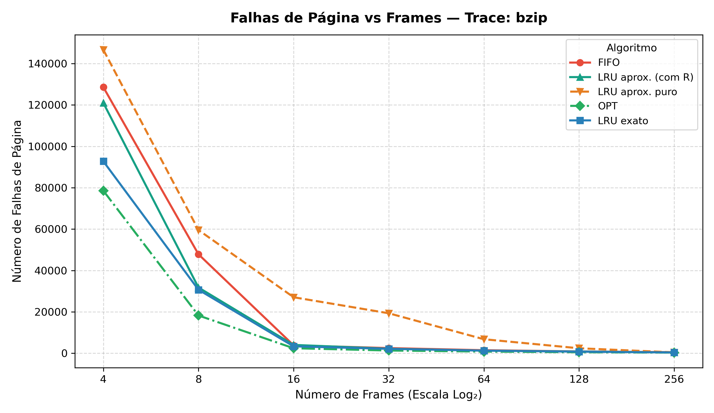
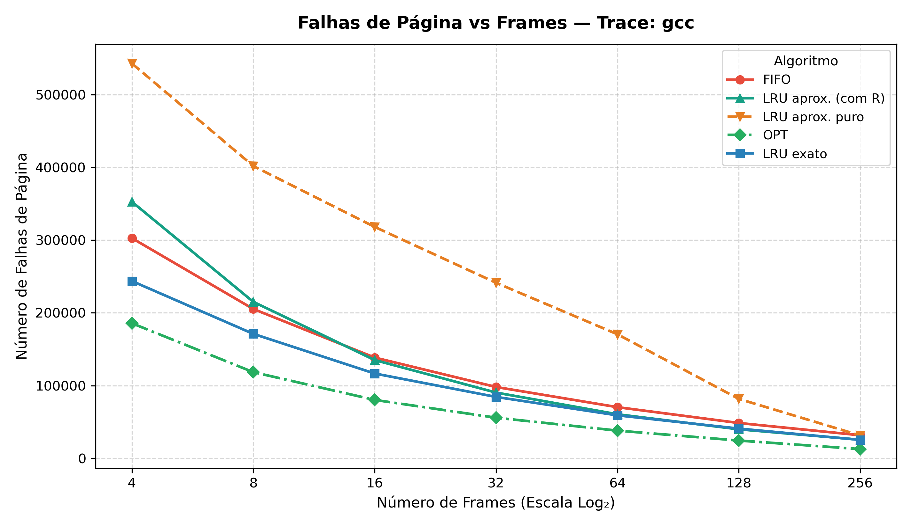
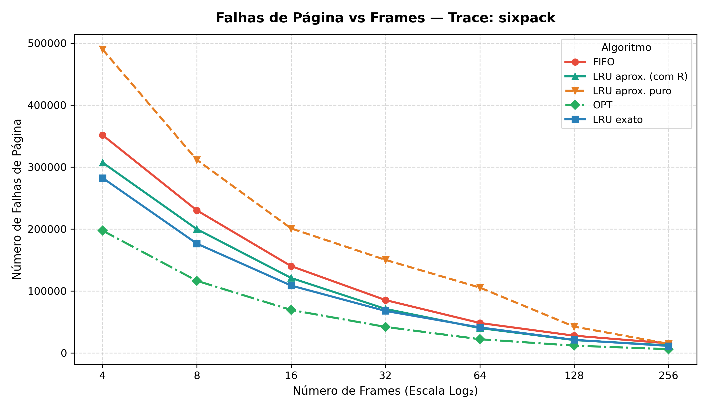
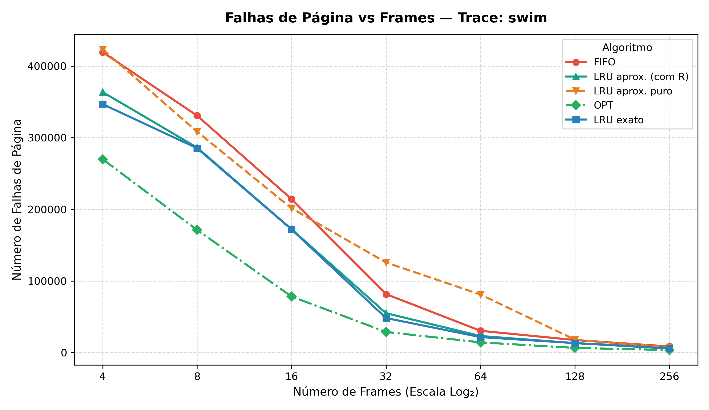
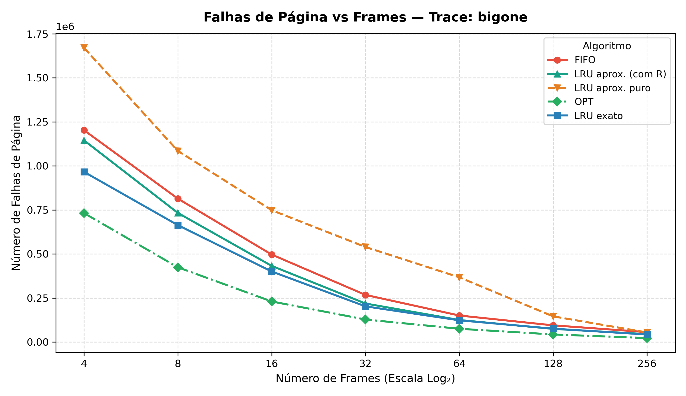
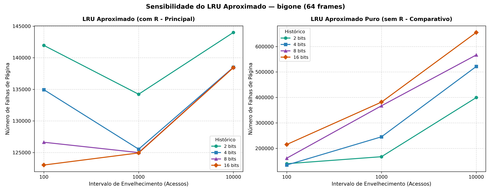

# Relatório: Avaliação de Políticas de Substituição de Páginas de Memória

**Disciplina:** Sistemas Operacionais  
**Autor:** Fade Hassan Husein Kanaan  
**Repositório:** https://github.com/fadekanaan/simulador-substituicao-paginas

---

## 1. Introdução

Em sistemas operacionais contemporâneos, a memória virtual fornece a cada processo um espaço de endereçamento contíguo e protegido, independente da quantidade física de memória RAM instalada. A implementação desse conceito apoia-se na técnica de **paginação sob demanda** (*demand paging*), na qual apenas as páginas do espaço de endereçamento virtual ativamente requisitadas pelo processador são carregadas nos quadros (*frames*) da memória física.

Quando uma instrução tenta acessar um endereço virtual cuja página correspondente não reside na RAM (bit de presença ausente na tabela de páginas), a Unidade de Gerenciamento de Memória (MMU) dispara uma interrupção de **falha de página** (*page fault*). O sistema operacional assume a execução para localizar a página requerida no armazenamento secundário (disco/SSD) e alocá-la em um quadro livre. Caso todos os quadros alocados ao processo ou sistema estejam ocupados, uma política de **substituição de páginas** precisa escolher uma página residente como vítima (*victim frame*) para ser despejada e ceder seu espaço à nova página.

A eficiência do algoritmo de substituição é determinante para o desempenho do computador: transferências de disco possuem latência na escala de milissegundos ou microssegundos, enquanto o acesso à RAM opera na escala de dezenas de nanossegundos. Escolhas inadequadas de substituição causam a degradação severa do sistema por sobrecarga de paginação (*thrashing*).

Este relatório avalia experimentalmente quatro políticas clássicas de substituição de páginas sobre **cinco traces reais de execução** (`bigone`, `bzip`, `gcc`, `sixpack` e `swim`), investigando o impacto da alocação de quadros (de 4 a 256 frames). O algoritmo de envelhecimento (*Aging*) é analisado em duas variantes: a **variante principal ("com R")**, que utiliza o bit de referência atual na decisão de substituição para contornar a vulnerabilidade de páginas recém-carregadas, e a **variante comparativa ("puro")**, que considera unicamente o contador acumulado nos tiques anteriores.

---

## 2. Metodologia

### 2.1 Descrição dos Traces de Memória
Os experimentos foram executados sobre arquivos de *trace* contendo sequências de acessos à memória em arquitetura de 32 bits (o enunciado não descreve os programas de origem dos traces):
- **`bzip.trace`**: 1.000.000 de acessos.
- **`gcc.trace`**: 1.000.000 de acessos.
- **`sixpack.trace`**: 1.000.000 de acessos.
- **`swim.trace`**: 1.000.000 de acessos.
- **`bigone.trace`**: 4.000.000 de acessos.

Cada linha dos traces contém um endereço de 32 bits em representação hexadecimal e o identificador da operação (`R` para leitura ou `W` para escrita), por exemplo: `31348900 W`. Linhas vazias ou fora do padrão foram filtradas durante o carregamento.

### 2.2 Estrutura da Memória e Tamanho de Página
Adotou-se o tamanho de página convencional de **4.096 bytes (4 KB)**, correspondente a $2^{12}$ bytes. Em uma arquitetura com endereços de 32 bits:
- Os 12 bits menos significativos definem o deslocamento (*offset*) intra-página.
- Os 20 bits mais significativos identificam unicamente o **número da página virtual**.

A conversão foi implementada através do operador de deslocamento de bits à direita:
$$\text{numero\_pagina} = \text{endereco} \gg 12$$

A leitura dos traces mantém estritamente a sequência cronológica completa de todas as referências à memória, sem descartar acessos consecutivos à mesma página. Essa fidelidade é fundamental para que algoritmos dependentes de temporização (*Aging*) realizem o deslocamento e o envelhecimento de contadores nas marcas de tempo exatas.

### 2.3 Algoritmos Avaliados

Em todas as simulações, a memória inicia vazia, contabilizando os primeiros carregamentos de páginas distintas como falhas compulsórias (*cold faults*).

1. **FIFO (First-In, First-Out):**
   - **Mecanismo:** Estruturado com uma fila duplamente encadeada (`collections.deque`) para manter a ordem cronológica de inserção e um conjunto (`set`) para buscas em tempo constante $O(1)$. Quando a memória está cheia, a página na cabeça da fila (carregada há mais tempo) é substituída. Acertos a páginas já residentes não modificam a fila.
   - **Propriedades:** De custo $O(1)$ por operação e trivial implementação, mas desconsidera o princípio de localidade temporal e pode sofrer da **Anomalia de Belady**.

2. **LRU Aproximado (Aging / Envelhecimento com Bit de Referência):**
   - **Mecanismo Base:** Cada quadro residente dispõe de um contador de $n_{\text{bits}}$ bits (padrão: 8 bits) e de um bit de referência de hardware $R$. A cada acesso à página residente, o hardware/sistema marca $R \leftarrow 1$. Novas páginas entram com contador 0 e $R=1$. A cada `intervalo` acessos (tique de relógio, padrão: 1.000 referências), o tratador de interrupção desloca os contadores de todas as páginas residentes à direita (`>> 1`), insere o bit $R$ na posição mais significativa (MSB) e zera $R$:
     $$\text{contador} \leftarrow (\text{contador} \gg 1) \mid (R \ll (n_{\text{bits}} - 1)); \quad R \leftarrow 0$$
   - **Decisão de Projeto — Variante Principal ("Aging com R"):** O enunciado não especifica como tratar o bit de referência $R$ entre dois tiques de relógio. Como o sistema operacional tem acesso direto ao bit $R$ na tabela de páginas no momento em que ocorre uma falha, adotou-se como política principal utilizar o bit $R$ vigente como o bit mais significativo virtual na chave de substituição:
     $$\text{chave} = ((\text{contador} \gg 1) \mid (R \ll (n_{\text{bits}} - 1)), \text{ordem\_chegada})$$
     Dessa forma, páginas acessadas no intervalo corrente (inclusive páginas recém-carregadas) não são tratadas com prioridade zero de descarte.
   - **Variante Comparativa ("Aging Puro"):** Avalia o envelhecimento clássico estrito no qual a chave de vítima considera exclusivamente o contador acumulado $(\text{contador}, \text{ordem\_chegada})$. Mantida no estudo para quantificar o ganho obtido pela consideração do bit $R$ atual.

3. **OPT (Ótimo de Belady / MIN):**
   - **Mecanismo:** Substitui a página residente cujo próximo acesso ocorrerá mais distante no tempo futuro (ou que não voltará a ser referenciada). Implementado com pré-cálculo da lista `proximo_uso` em uma varredura reversa do trace ($O(N)$), mantendo para cada página residente o índice do seu próximo acesso e elegendo a vítima via `max()`.
   - **Propriedades:** Representa o limite inferior teórico absoluto (menor quantidade possível de falhas para qualquer sequência fixa). Não pode ser implementado em sistemas operacionais reais porque exige conhecimento prévio do futuro, servindo como padrão-ouro de comparação.

4. **LRU Exato (Least Recently Used):**
   - **Mecanismo:** Implementado com `collections.OrderedDict`. A cada referência a uma página residente, ela é deslocada para a cauda da estrutura (`move_to_end`). Ao ocorrer uma substituição, a página na cabeça (menos recentemente acessada) é removida em $O(1)$.
   - **Propriedades:** Política de pilha que explora a localidade temporal estrita, imune à Anomalia de Belady.

### 2.4 Parâmetros dos Experimentos
- **Quadros de Memória (Frames):** 4, 8, 16, 32, 64, 128 e 256 quadros.
- **Configuração Padrão do Aging:** $n_{\text{bits}} = 8$ bits, $\text{intervalo} = 1.000$ acessos.
- **Estudo de Sensibilidade:** Variação sistemática de $n_{\text{bits}} \in \{2, 4, 8, 16\}$ bits e $\text{intervalo} \in \{100, 1.000, 10.000\}$ acessos para ambas as variantes no trace `bigone` com 64 quadros fixos.

### 2.5 Limitações do Modelo
O ambiente de simulação adota algumas simplificações metodológicas:
- **Processo Único:** Cada trace é avaliado isoladamente, simulando um único processo em execução, sem concorrência de múltiplos processos ou divisão entre políticas de alocação global e local de quadros.
- **Estado Inicial da Memória:** Toda a memória física inicia vazia; portanto, os primeiros acessos a páginas distintas contam como falhas compulsórias (*cold faults*).
- **Tipo de Acesso (R/W):** As operações de leitura (`R`) e escrita (`W`) não diferenciam o tratamento das páginas (não há distinção por *dirty bit* / página modificada para escolha de vítima).
- **Decisão de Projeto no Aging:** O modelo de aging com R foi introduzido como solução para a indefinição de uso do bit R entre tiques, sendo comparado explicitamente contra o aging puro visto em aula.

---

## 3. Resultados

Os dados a seguir foram obtidos através da execução do simulador sobre a totalidade dos traces e configurações especificadas.

### 3.1 Resultados por Trace

#### Trace: `bzip` (1.000.000 de acessos)

| Frames | Falhas FIFO | Taxa FIFO (%) | Falhas LRU Aprox. (com R) | Taxa LRU Aprox. (%) | Falhas LRU Aprox. Puro | Taxa Puro (%) | Falhas OPT | Taxa OPT (%) | Falhas LRU Exato | Taxa LRU Exato (%) |
| :---: | :---: | :---: | :---: | :---: | :---: | :---: | :---: | :---: | :---: | :---: |
| **4** | 128.601 | 12,86% | 121.001 | 12,10% | 146.668 | 14,67% | 78.562 | 7,86% | 92.770 | 9,28% |
| **8** | 47.828 | 4,78% | 31.766 | 3,18% | 59.553 | 5,96% | 18.251 | 1,83% | 30.691 | 3,07% |
| **16** | 3.820 | 0,38% | 4.032 | 0,40% | 27.072 | 2,71% | 2.427 | 0,24% | 3.344 | 0,33% |
| **32** | 2.497 | 0,25% | 2.195 | 0,22% | 19.329 | 1,93% | 1.330 | 0,13% | 2.133 | 0,21% |
| **64** | 1.467 | 0,15% | 1.273 | 0,13% | 6.778 | 0,68% | 821 | 0,08% | 1.264 | 0,13% |
| **128** | 891 | 0,09% | 842 | 0,08% | 2.408 | 0,24% | 497 | 0,05% | 771 | 0,08% |
| **256** | 511 | 0,05% | 394 | 0,04% | 435 | 0,04% | 317 | 0,03% | 397 | 0,04% |

---

#### Trace: `gcc` (1.000.000 de acessos)

| Frames | Falhas FIFO | Taxa FIFO (%) | Falhas LRU Aprox. (com R) | Taxa LRU Aprox. (%) | Falhas LRU Aprox. Puro | Taxa Puro (%) | Falhas OPT | Taxa OPT (%) | Falhas LRU Exato | Taxa LRU Exato (%) |
| :---: | :---: | :---: | :---: | :---: | :---: | :---: | :---: | :---: | :---: | :---: |
| **4** | 302.860 | 30,29% | 352.883 | 35,29% | 543.116 | 54,31% | 185.754 | 18,58% | 243.809 | 24,38% |
| **8** | 205.368 | 20,54% | 215.242 | 21,52% | 402.027 | 40,20% | 118.480 | 11,85% | 171.186 | 17,12% |
| **16** | 138.539 | 13,85% | 135.147 | 13,51% | 318.296 | 31,83% | 80.307 | 8,03% | 116.604 | 11,66% |
| **32** | 98.067 | 9,81% | 90.390 | 9,04% | 241.418 | 24,14% | 55.802 | 5,58% | 84.401 | 8,44% |
| **64** | 70.315 | 7,03% | 60.510 | 6,05% | 170.595 | 17,06% | 38.050 | 3,81% | 59.089 | 5,91% |
| **128** | 48.526 | 4,85% | 39.874 | 3,99% | 81.681 | 8,17% | 24.391 | 2,44% | 40.821 | 4,08% |
| **256** | 31.698 | 3,17% | 25.480 | 2,55% | 31.423 | 3,14% | 12.667 | 1,27% | 25.308 | 2,53% |

---

#### Trace: `sixpack` (1.000.000 de acessos)

| Frames | Falhas FIFO | Taxa FIFO (%) | Falhas LRU Aprox. (com R) | Taxa LRU Aprox. (%) | Falhas LRU Aprox. Puro | Taxa Puro (%) | Falhas OPT | Taxa OPT (%) | Falhas LRU Exato | Taxa LRU Exato (%) |
| :---: | :---: | :---: | :---: | :---: | :---: | :---: | :---: | :---: | :---: | :---: |
| **4** | 351.810 | 35,18% | 307.451 | 30,75% | 490.183 | 49,02% | 197.551 | 19,76% | 282.620 | 28,26% |
| **8** | 230.168 | 23,02% | 199.842 | 19,98% | 311.681 | 31,17% | 116.407 | 11,64% | 176.496 | 17,65% |
| **16** | 140.083 | 14,01% | 120.952 | 12,10% | 200.945 | 20,09% | 69.325 | 6,93% | 108.682 | 10,87% |
| **32** | 85.283 | 8,53% | 71.034 | 7,10% | 150.192 | 15,02% | 41.955 | 4,20% | 67.747 | 6,77% |
| **64** | 48.301 | 4,83% | 40.040 | 4,00% | 105.447 | 10,54% | 22.083 | 2,21% | 41.186 | 4,12% |
| **128** | 27.778 | 2,78% | 20.691 | 2,07% | 42.409 | 4,24% | 11.690 | 1,17% | 21.090 | 2,11% |
| **256** | 15.440 | 1,54% | 12.068 | 1,21% | 14.674 | 1,47% | 5.981 | 0,60% | 11.240 | 1,12% |

---

#### Trace: `swim` (1.000.000 de acessos)

| Frames | Falhas FIFO | Taxa FIFO (%) | Falhas LRU Aprox. (com R) | Taxa LRU Aprox. (%) | Falhas LRU Aprox. Puro | Taxa Puro (%) | Falhas OPT | Taxa OPT (%) | Falhas LRU Exato | Taxa LRU Exato (%) |
| :---: | :---: | :---: | :---: | :---: | :---: | :---: | :---: | :---: | :---: | :---: |
| **4** | 419.509 | 41,95% | 363.826 | 36,38% | 423.303 | 42,33% | 270.046 | 27,00% | 346.936 | 34,69% |
| **8** | 330.893 | 33,09% | 286.297 | 28,63% | 308.553 | 30,86% | 171.244 | 17,12% | 285.375 | 28,54% |
| **16** | 214.295 | 21,43% | 172.233 | 17,22% | 201.448 | 20,14% | 78.312 | 7,83% | 171.961 | 17,20% |
| **32** | 81.638 | 8,16% | 55.022 | 5,50% | 125.839 | 12,58% | 28.826 | 2,88% | 48.254 | 4,83% |
| **64** | 30.422 | 3,04% | 23.173 | 2,32% | 81.047 | 8,10% | 14.289 | 1,43% | 21.656 | 2,17% |
| **128** | 17.523 | 1,75% | 13.213 | 1,32% | 18.056 | 1,81% | 6.518 | 0,65% | 13.250 | 1,32% |
| **256** | 8.551 | 0,86% | 6.916 | 0,69% | 7.175 | 0,72% | 3.572 | 0,36% | 5.673 | 0,57% |

---

#### Trace: `bigone` (4.000.000 de acessos)

| Frames | Falhas FIFO | Taxa FIFO (%) | Falhas LRU Aprox. (com R) | Taxa LRU Aprox. (%) | Falhas LRU Aprox. Puro | Taxa Puro (%) | Falhas OPT | Taxa OPT (%) | Falhas LRU Exato | Taxa LRU Exato (%) |
| :---: | :---: | :---: | :---: | :---: | :---: | :---: | :---: | :---: | :---: | :---: |
| **4** | 1.202.780 | 30,07% | 1.145.161 | 28,63% | 1.670.581 | 41,76% | 731.913 | 18,30% | 966.135 | 24,15% |
| **8** | 814.257 | 20,36% | 733.147 | 18,33% | 1.085.323 | 27,13% | 424.381 | 10,61% | 663.748 | 16,59% |
| **16** | 496.736 | 12,42% | 432.364 | 10,81% | 748.494 | 18,71% | 230.369 | 5.76% | 400.591 | 10,01% |
| **32** | 267.469 | 6,69% | 218.632 | 5,47% | 539.395 | 13,48% | 127.910 | 3,20% | 202.533 | 5,06% |
| **64** | 150.507 | 3,76% | 124.993 | 3,12% | 367.318 | 9,18% | 75.228 | 1,88% | 123.192 | 3,08% |
| **128** | 94.715 | 2,37% | 74.613 | 1,87% | 145.666 | 3,64% | 43.058 | 1,08% | 75.925 | 1,90% |
| **256** | 56.193 | 1,40% | 44.837 | 1,12% | 54.288 | 1,36% | 22.434 | 0,56% | 42.600 | 1,06% |

---

### 3.2 Experimento de Sensibilidade (LRU Aproximado / Aging)
Configuração: Trace `bigone`, 64 quadros (frames), 4.000.000 de acessos.

#### Variante Principal: LRU Aproximado (com R)

| Tamanho Histórico ($n_{\text{bits}}$) | Intervalo = 100 acessos | Intervalo = 1.000 acessos | Intervalo = 10.000 acessos |
| :---: | :---: | :---: | :---: |
| **2 bits** | 141.952 (3,55%) | 134.226 (3,36%) | 144.004 (3,60%) |
| **4 bits** | 134.946 (3,37%) | 125.535 (3,14%) | 138.492 (3,46%) |
| **8 bits** | 126.627 (3,17%) | 124.993 (3,12%) | 138.470 (3,46%) |
| **16 bits** | 123.023 (3,08%) | 124.936 (3,12%) | 138.431 (3,46%) |

#### Variante Comparativa: LRU Aproximado Puro (sem R)

| Tamanho Histórico ($n_{\text{bits}}$) | Intervalo = 100 acessos | Intervalo = 1.000 acessos | Intervalo = 10.000 acessos |
| :---: | :---: | :---: | :---: |
| **2 bits** | 139.774 (3,49%) | 167.320 (4,18%) | 399.498 (9,99%) |
| **4 bits** | 134.618 (3,37%) | 245.416 (6,14%) | 521.569 (13,04%) |
| **8 bits** | 161.426 (4,04%) | 367.318 (9,18%) | 566.731 (14,17%) |
| **16 bits** | 215.222 (5,38%) | 381.759 (9,54%) | 655.233 (16,38%) |

---

## 4. Discussão

### 4.1 Comparação entre os Algoritmos
- **Superioridade do LRU Exato sobre o FIFO:** Em todos os traces avaliados, o LRU Exato apresentou número de falhas sistematicamente inferior ao FIFO. No trace `bzip` com 8 quadros, por exemplo, o LRU registrou 30.691 falhas contra 47.828 do FIFO (uma redução de **35,8%** nas falhas). Isso decorre diretamente da exploração da **localidade temporal**: páginas referenciadas recentemente possuem alta probabilidade de reuso a curto prazo.
- **A Limitação de Granularidade do Aging Puro:**
  O aging puro só atualiza o histórico a cada tique (a cada `intervalo` acessos). Uma página recém-carregada entra com contador 0 e só acumula histórico no próximo tique. Até lá, ela tem o menor contador entre as residentes e é a candidata natural à vítima, mesmo tendo sido a mais recentemente usada. Quanto maior o intervalo, mais tempo as páginas novas ficam nessa situação, e mais o algoritmo erra ao expulsar páginas que ainda seriam úteis. É uma consequência da granularidade do tique, e explica por que um intervalo menor (100) tem desempenho muito melhor que um maior (10.000).
- **Impacto da Variante Principal ("com R") vs Aging Puro:**
  Ao incorporar o bit $R$ vigente como MSB virtual na escolha da vítima, essa limitação é amplamente mitigada. No teste com 64 quadros em cada trace, a variante com R reduziu as falhas em relação ao puro de forma expressiva:
  - `bzip`: de 6.778 para 1.273 falhas (**redução de 81,2%**).
  - `gcc`: de 170.595 para 60.510 falhas (**redução de 64,5%**).
  - `sixpack`: de 105.447 para 40.040 falhas (**redução de 62,0%**).
  - `swim`: de 81.047 para 23.173 falhas (**redução de 71,4%**).
  - `bigone`: de 367.318 para 124.993 falhas (**redução de 66,0%**).
- **LRU Aproximado (com R) vs FIFO e LRU Exato:**
  - Em relação ao FIFO, o LRU aproximado com R superou o FIFO em **32 das 35 combinações** testadas (91,4% dos casos). O FIFO gerou menos falhas apenas em 3 configurações específicas com poucos quadros (`bzip` com 16 quadros: 3.820 vs 4.032; `gcc` com 4 quadros: 302.860 vs 352.883; e `gcc` com 8 quadros: 205.368 vs 215.242).
  - Com 256 quadros, o LRU aproximado com R aproximou-se fortemente do LRU exato em todos os traces: `bzip` (394 vs 397, 0,99x); `gcc` (25.480 vs 25.308, 1,01x); `sixpack` (12.068 vs 11.240, 1,07x); `swim` (6.916 vs 5.673, 1,22x); e `bigone` (44.837 vs 42.600, 1,05x).
  - É interessante notar que o LRU aproximado (com R) obteve menos falhas que o LRU exato em **6 das 35 combinações** testadas (por exemplo, `sixpack` com 64 quadros: 40.040 vs 41.186 falhas; `gcc` com 128 quadros: 39.874 vs 40.821 falhas). Embora possa surpreender à primeira vista, isso ocorre porque o LRU exato não é ótimo, sendo apenas uma heurística; assim, variações na ordem de substituição decorrentes da discretização temporal podem, fortuitamente, resultar em menos falhas totais para certos padrões de acesso.

### 4.2 Impacto do Número de Quadros de Memória (Frames)
- Todos os gráficos exibem a curva de rendimentos decrescentes:
  - No `bzip`, a transição de 4 para 16 quadros reduz as falhas de 128.601 para 3.820 no FIFO (queda de **97,0%**). Taxas estritamente abaixo de **0,1% são alcançadas apenas a partir de 128 quadros** (com 64 quadros a taxa é de 0,15% no FIFO, 0,13% no LRU exato e 0,13% no Aging com R; com 128 quadros passa a 0,09% no FIFO e 0,08% no LRU exato e Aging com R).
  - No `gcc`, o declínio é gradual: mesmo com 256 quadros ocorrem entre 12.667 (OPT) e 31.698 (FIFO) falhas (1,27% a 3,17%).
  - No `swim`, há uma queda abrupta entre 16 quadros (171.961 falhas no LRU) e 32 quadros (48.254 falhas), caracterizando o ponto em que o conjunto de trabalho principal da aplicação passa a residir na memória física.

### 4.3 Efeito dos Parâmetros do LRU Aproximado ($n_{\text{bits}}$ e Intervalo)
A análise comparativa entre as duas variantes na tabela de sensibilidade (`bigone`, 64 quadros) revela:
1. **Comportamento da variante com R:** A inclusão do bit $R$ na chave da vítima estabilizou fortemente a política. A taxa de falhas variou em uma faixa estreita entre **3,08% e 3,60%** (123.023 a 144.004 falhas) para todas as combinações de bits e intervalos testadas, aproximando-se do LRU exato (123.192 falhas, 3,08%).
2. **Comportamento da variante pura:** Sob o intervalo padrão (8 bits, 1.000 acessos), o aging puro gerou **367.318 falhas (9,18%)**, quase o triplo do LRU exato. Além disso, degradou-se acentuadamente com o intervalo de 10.000 acessos (atingindo até 655.233 falhas / 16,38% com 16 bits), confirmando a perda de resolução temporal.
3. **Observação sobre o número de bits:** Na variante pura, observa-se que aumentar o número de bits para 16 aumentou as falhas em todos os intervalos testados (215.222 para intervalo 100; 381.759 para 1.000; e 655.233 para 10.000). Na variante com R, configurações com 8 e 16 bits registraram as menores falhas absolutas para intervalos de 100 e 1.000 acessos (123.023 e 124.936 falhas); além disso, no gráfico da variante com R, as curvas de 4, 8 e 16 bits praticamente coincidem no intervalo de 10.000 acessos (variando apenas entre 138.431 e 138.492 falhas). Essas constatações refletem estritamente os dados obtidos nas medições da simulação.

### 4.4 Comparação com o Limite Teórico (OPT)
- O algoritmo Ótimo de Belady estabeleceu o limite inferior teórico absoluto em todas as 35 combinações de traces e quadros ($OPT \le \text{todos os outros}$).
- O OPT gerou de **15,3% a 54,5% menos falhas** do que a melhor política online em cada caso, com uma **redução média de 36,4%** (aproximadamente 36% a 37%).
  - A menor diferença percentual ocorreu no trace `bzip` com 4 quadros (OPT com 78.562 falhas vs LRU exato com 92.770, redução de 15,3%).
  - A maior diferença percentual ocorreu no trace `swim` com 16 quadros (OPT com 78.312 falhas vs LRU exato com 171.961, redução de 54,5%).

---

## 5. Conclusão

Os experimentos quantitativos permitiram analisar com precisão o comportamento das políticas de substituição:
1. O **LRU Exato** superou o FIFO em todos os traces, evidenciando a robustez da heurística de localidade temporal.
2. A análise do **LRU aproximado (Aging)** comprovou experimentalmente a limitação de granularidade do modelo puro com intervalo de 1.000 acessos. A decisão de projeto de considerar o bit $R$ vigente no instante da falha ("Aging com R") corrigiu essa vulnerabilidade de forma notável, reduzindo as falhas entre **62% e 81%** com 64 quadros e igualando ou aproximando-se do LRU exato com 256 quadros.
3. O algoritmo **Ótimo (OPT)** confirma seu papel fundamental como referencial analítico invariante, delimitando a barreira de desempenho inalcançável por políticas que não conhecem o futuro.
